## {data-menu-title="Learning outcomes"}

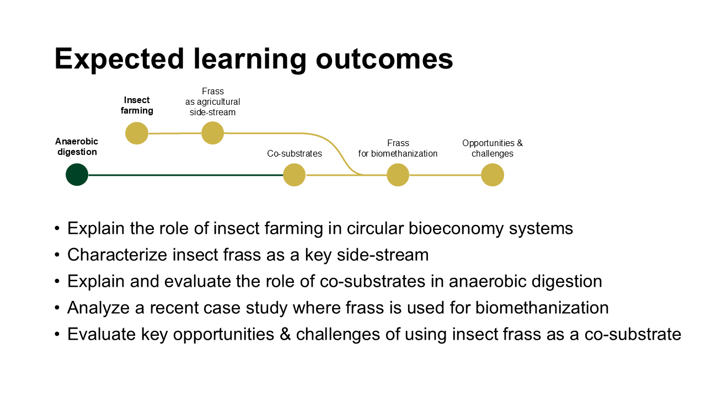{.absolute left=0 bottom=0 width="100%"}

## {data-menu-title="Bioconversion"}

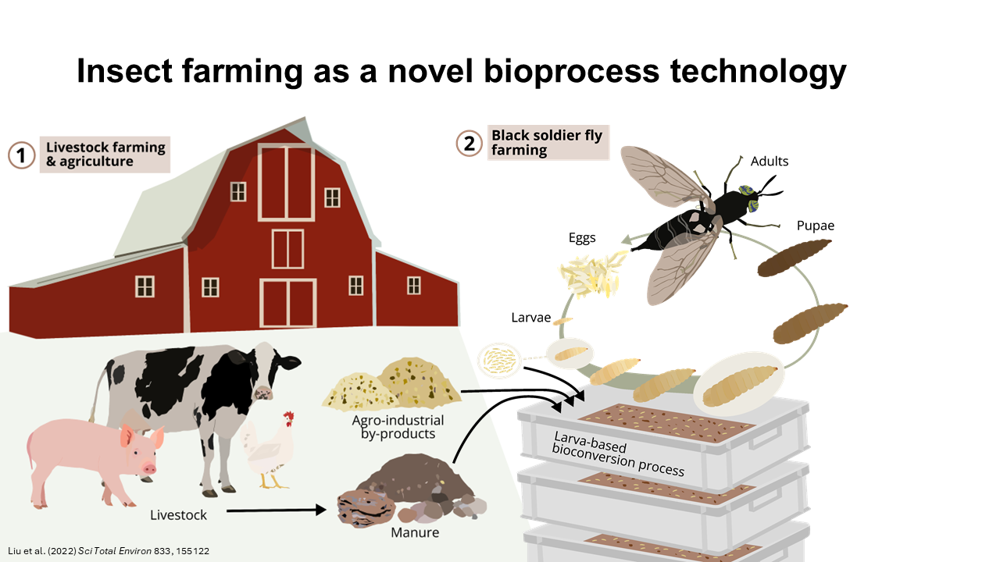{.absolute left=0 bottom=0 width="100%"}

## {data-menu-title="Harvested larvae" background-image="larvae.gif" background-size="cover"}

## {data-menu-title="Bioconversion"}
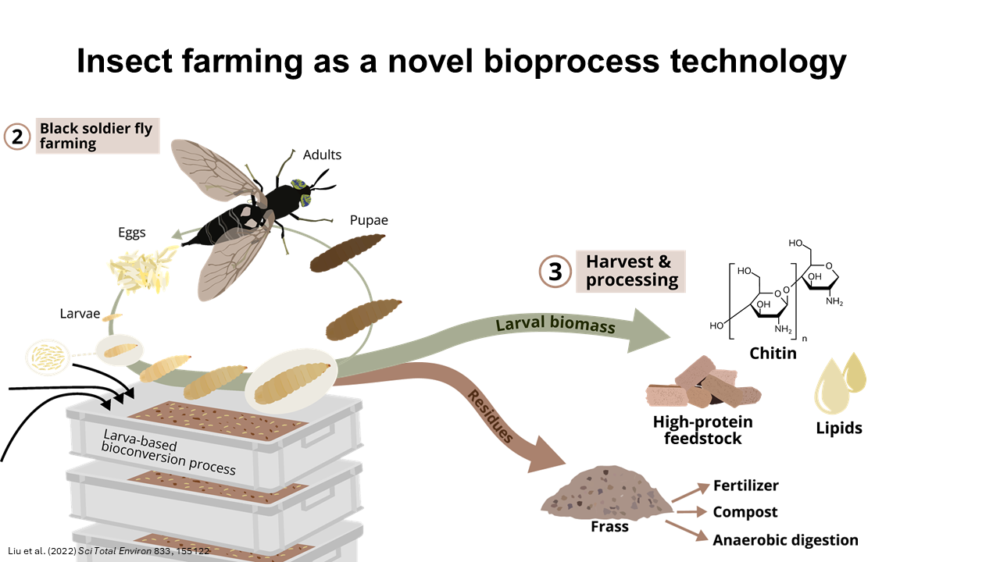{.absolute left=0 bottom=0 width="100%"}

## {data-menu-title="Insect frass"}
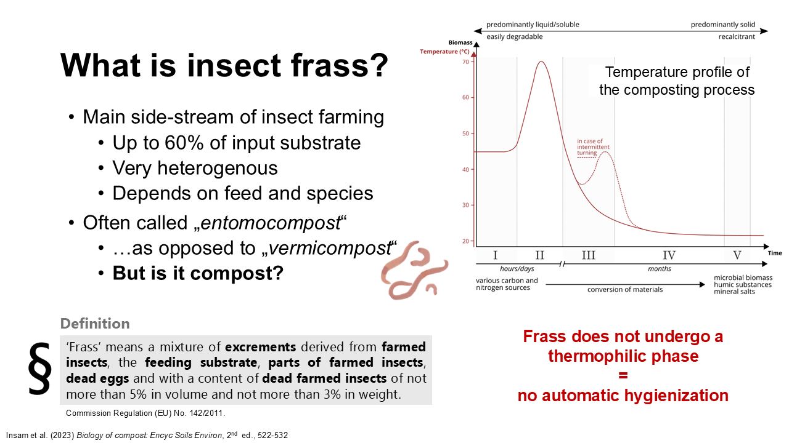{.absolute left=0 bottom=0 width="100%"}

## {data-menu-title="Insect frass"}

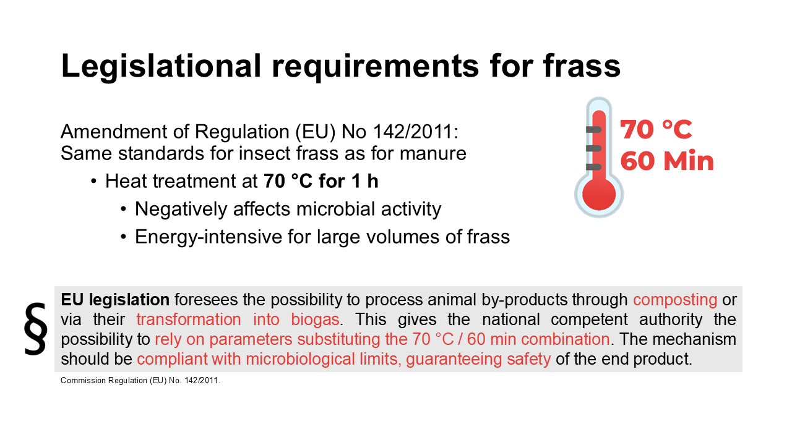{.absolute left=0 bottom=0 width="100%"}

## {data-menu-title="Insect frass"}

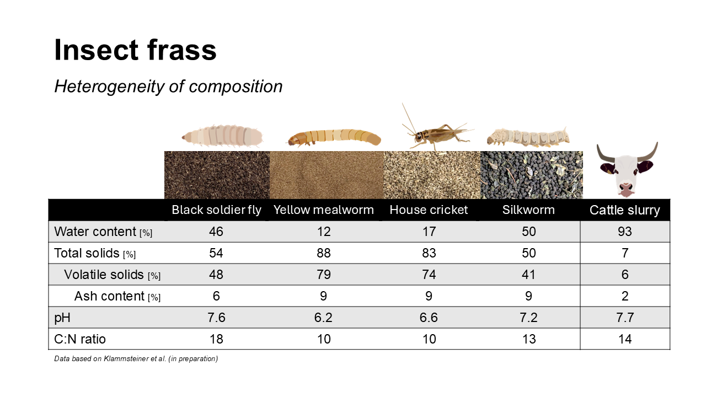{.absolute left=0 bottom=0 width="100%"}

## {data-menu-title="Co-substrates"}

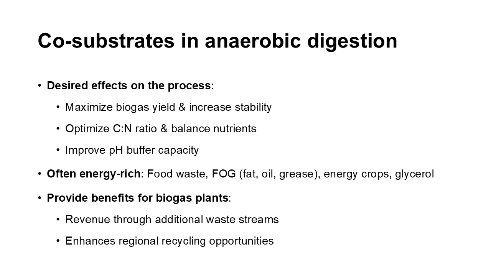{.absolute left=0 bottom=0 width="100%"}

## {data-menu-title="Insect frass as co-substrate"}

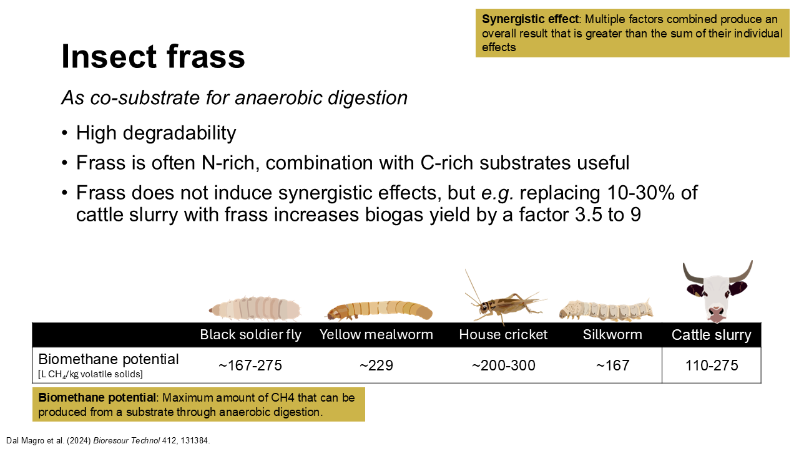{.absolute left=0 bottom=0 width="100%"}

## {data-menu-title="Insect frass as co-substrate"}

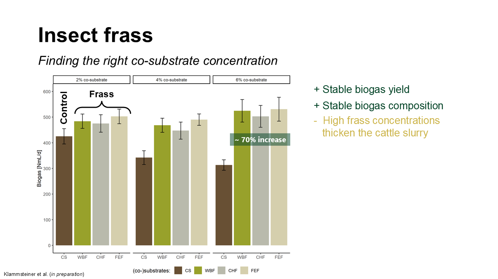{.absolute left=0 bottom=0 width="100%"}

## {data-menu-title="Insect frass as co-substrate"}

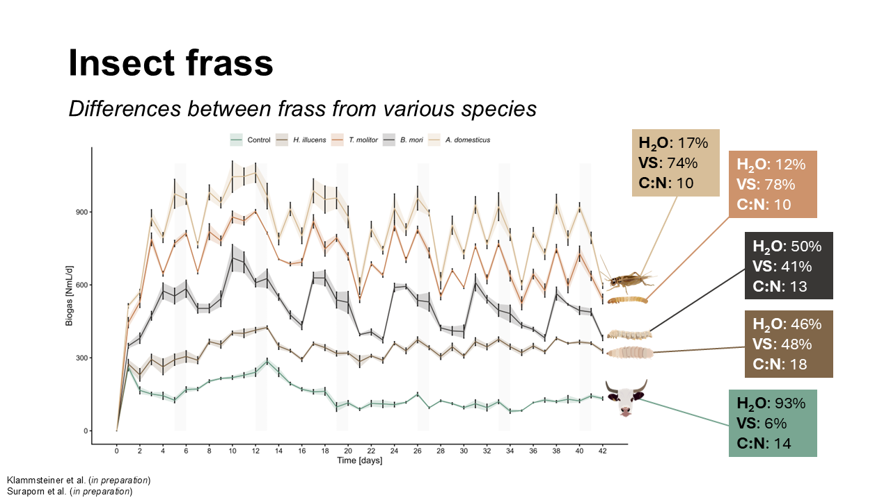{.absolute left=0 bottom=0 width="100%"}

## {data-menu-title="Insect frass as co-substrate"}

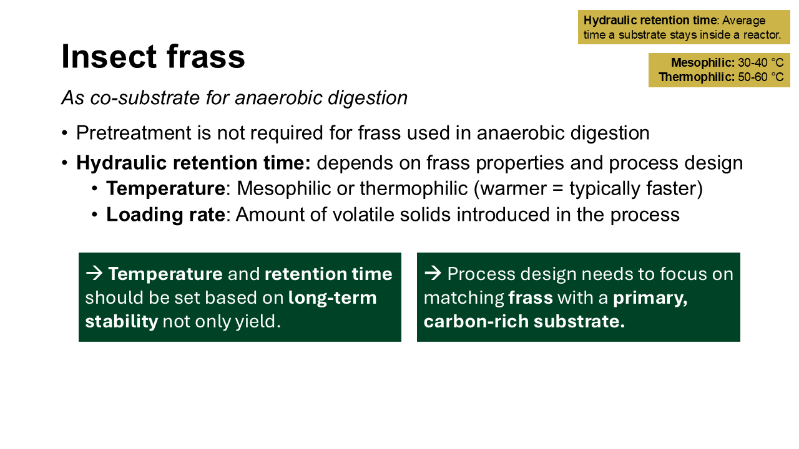{.absolute left=0 bottom=0 width="100%"}

## {data-menu-title="Case study"}

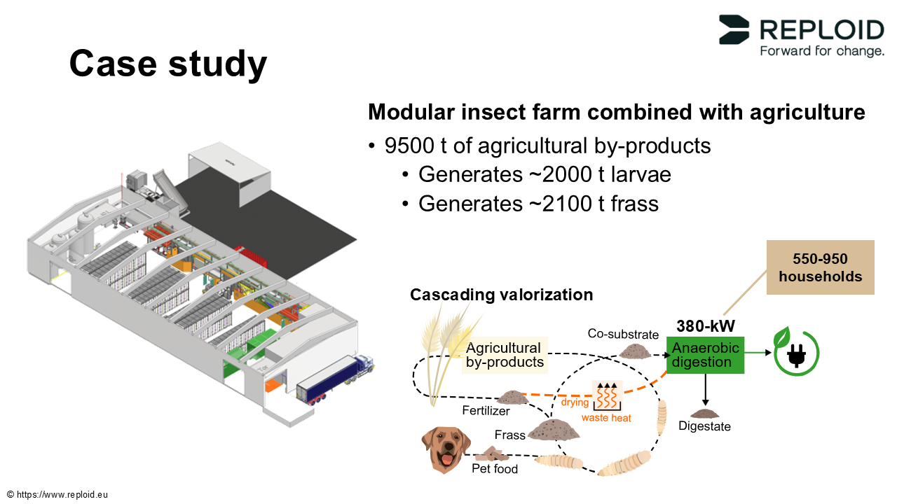{.absolute left=0 bottom=0 width="100%"}

## {data-menu-title="Challenges and opportunities"}

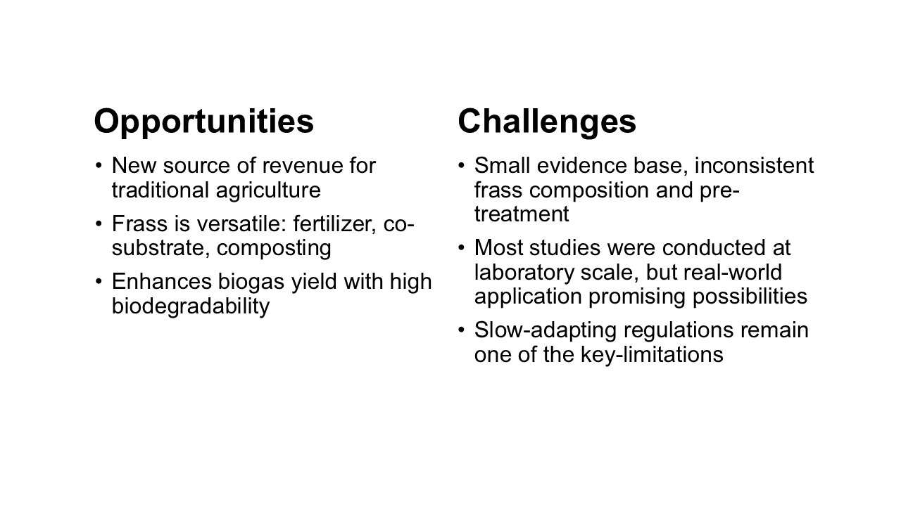{.absolute left=0 bottom=0 width="100%"}

